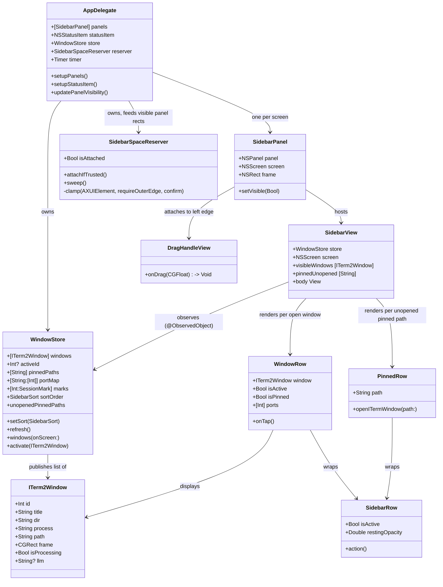
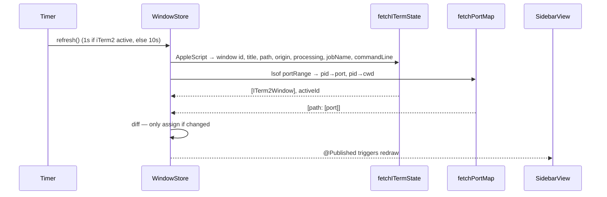

# CRC — iterm2-status-bar

Class-Responsibility-Collaborator cards for the main objects.

## Data flow

## Key design decisions

| Decision | Reason |
|---|---|
| Window selection by `id of w` (AppleScript) | Positional index shifts as windows open/close — stable id avoids off-by-one |
| Port range defaults to 4000–4999 | Most projects bind near 4000; `portRange` overrides it |
| Two lsof calls (ports→pid, pid→cwd) | Single call can't give both port and cwd; -d cwd filters to just the working dir fd |
| Equality-guard before `@Published` assign | Prevents SwiftUI from repainting on every poll tick when data hasn't changed |
| `~/Library/Application Support/iTermSidebar/instance.lock` (fixed path) | `FileManager.temporaryDirectory` is session-scoped — different launches got different paths, defeating the singleton lock |
| AppleScript returns nested lists | Field boundaries survive any characters in titles/paths (replaced `\|\|\|`-joined strings) |
| Skip AppleScript when iTerm2 isn't running | `tell application` would relaunch iTerm2 after the user quits it |
| Sidebar visibility = `Prefs.sidebarEnabled && screen has windows` | One method shows/hides panels, so Hide survives refreshes |
| Trim windows via Accessibility, not reserve space | macOS has no public API to shrink `visibleFrame` |
