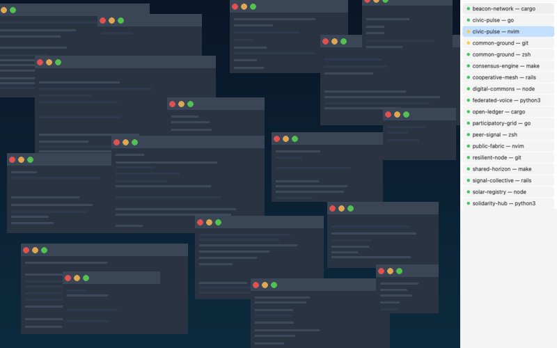
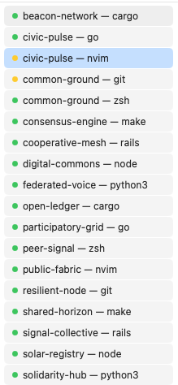

# iterm2-status-bar

A lightweight macOS status bar app that puts a persistent sidebar on every monitor,
showing all open iTerm2 windows — filtered to the windows on each screen.





## Features

- One sidebar per connected display, anchored to the right edge. Menu bar → Tabs switches that screen to a horizontal shelf under the menu bar instead
- Shows only the iTerm2 windows on that screen. Rows are ordered by folder; menu bar → Sort by Attention puts working, then needs-review, then the focused window, then dormant first
- Click any entry to raise and focus that window
- Yellow ring = session is working; green dot = the focused window, idle; blue dot = needs a look; gray dot = dormant
- Listening dev servers (TCP 4000–4999 by default) appear under the window whose folder they run in; click to open
- Pinned projects (`~/.config/iterm-sidebar/pinned.txt`) that aren't open yet; click to open a new iTerm2 window there
- Drag the sidebar's left edge to widen it (up to +100pt)
- Keeps other apps' windows clear of the sidebar and the tab shelf: a zoom or resize into that chrome is pulled back out
- Refreshes every 1s when iTerm2 is active, every 10s in the background
- Menu bar icon — Hide/Show Sidebar, Tabs, Sort by Attention, Keep Windows Clear of Sidebar, Quit
- No Dock icon

## Requirements

- macOS 13+, Apple silicon (tested on macOS 26.6)
- iTerm2

## Install

```bash
git clone https://github.com/yourusername/iterm2-status-bar
cd iterm2-status-bar
bash build-app.sh
```

This compiles the app and opens it. On first launch:

1. Grant **Automation** access to control iTerm2
   (System Settings → Privacy & Security → Automation → iTermSidebar → iTerm2)
2. Grant **Accessibility** access when prompted
   (System Settings → Privacy & Security → Accessibility → iTermSidebar).
   Only needed for *Keep Windows Clear of Sidebar*; turn that off in the menu and the app never asks.
   If the menu item says *(Needs Accessibility)* while the switch in Settings is on, the grant is stale:
   remove the entry with **−**, then add `iTermSidebar.app` again.
   Dev builds are ad-hoc signed, so macOS may ask again after each rebuild.

## Install to /Applications

```bash
rm -rf /Applications/iTermSidebar.app
cp -r iTermSidebar.app /Applications/iTermSidebar.app
open /Applications/iTermSidebar.app
```

## Auto-start on login

Add `/Applications/iTermSidebar.app` to System Settings → General → Login Items.

## Usage

| Action | Result |
|--------|--------|
| Click a window name | Raises that iTerm2 window |
| Click a `· :4001` port | Opens `http://localhost:4001` |
| Click a pinned `+` row | Opens a new iTerm2 window in that folder |
| Drag sidebar left edge | Widens the sidebar |
| Click menu bar icon | Hide/Show Sidebar, Tabs, Sort by Attention, Keep Windows Clear of Sidebar, Quit |
| Yellow ring | Session is working (iTerm saw output recently) |
| Green dot | This is the focused window, and it is idle |
| Blue dot | Needs a look: work finished off to the side, or you left this window in the last 3 minutes |
| Gray dot | Dormant: idle, not focused, nothing new |

## How it works

The app uses AppleScript to query iTerm2 every few seconds:
- Window ids, titles, bounds, session paths, processing state, and the foreground job (`jobName`, `commandLine`)
- Maps each window to the screen that holds most of it
- Raises windows by stable iTerm2 window id
- A dot on the right edge of the row names the agent: orange Claude, black Grok, purple Codex. Other rows keep a hollow placeholder. `claude.exe` and `grok-1` count. The row text is the directory.

macOS has no public API to reserve screen-edge space (nothing like a Windows AppBar), so
zoom and tiling size windows underneath the sidebar and the tab shelf. The app watches other
apps' windows through the Accessibility API. A window created or resized into the list is
narrowed to the list's left edge; one zoomed under the shelf is pulled down to sit just
below it. A plain drag is left alone. So is a full-screen window, a window that would end
up narrower than 300pt, and a window that continues onto another display. If Accessibility
is missing, the app keeps checking and the menu item says so. Ad-hoc rebuilds make macOS
forget that grant, so dev builds sign with an Apple Development identity.

## Port range

Dev servers are scanned on TCP 4000–4999. To change that, set a `low-high` range and relaunch:

```bash
defaults write studio.civic.iterm-sidebar portRange 3000-4999
```

## Pinned projects

One folder per line in `~/.config/iterm-sidebar/pinned.txt`; `~` is expanded and `#` lines are comments.
Pinned folders without an open window are listed under **Pinned** on every sidebar.
Use **Edit Pinned Projects** at the bottom of the sidebar to open the file in TextEdit.

No network access. No data collection. Runs entirely locally.

## Build from source

Requirements: Xcode (Swift 6 toolchain).

```bash
bash build-app.sh   # swift build → iTermSidebar.app → open
swift test          # unit tests (parsing, geometry, pins, ports)
```

It's a Swift package (`Package.swift`, Swift 6 language mode, macOS 13 deployment target).
`build-app.sh` builds it with `swift build`, assembles `iTermSidebar.app`, and launches it via `open`.
If a build is already running, `open` only focuses it; quit it from the menu bar first.

| File | Responsibility |
|------|----------------|
| `Sources/iTermSidebar/main.swift` | Entry point, single-instance lock |
| `AppDelegate.swift` | Lifecycle, menu bar item, panel visibility |
| `SidebarPanel.swift` | Per-screen panel and drag-to-resize handle |
| `SidebarViews.swift` | SwiftUI rows and sidebar |
| `WindowStore.swift` | Observable state and refresh |
| `ITermClient.swift` | AppleScript queries and actions, result parsing |
| `Session.swift` | Dot state (working / active / review / dormant) and agent names |
| `Ports.swift` / `Pinned.swift` | `lsof` port scan / pinned-projects file |
| `SidebarSpaceReserver.swift` | Accessibility-based window trimming |
| `Geometry.swift` | Coordinate flips, screen assignment, trim math (pure, tested) |
| `Demo.swift` | Fake names for screenshots |
Use `LAUNCH=0 bash build-app.sh` to build without launching, or `TEAM_ID=… bash build-app.sh release` to sign and notarize.
Dev builds sign with your Apple Development identity when you have one (`DEV_IDENTITY` picks another) and fall back to ad-hoc, which loses Accessibility on every rebuild.

## License

MIT
